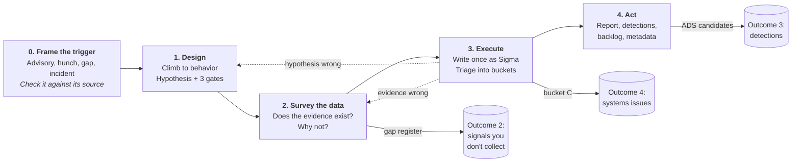

# Threat hunting, as a repeatable method

Most threat hunts ask one question: *is the bad thing here?* When the answer is
no, the hunt ends with "we looked and found nothing." That sentence asserts
nothing, and the work behind it is thrown away.

A hunt can produce five outcomes, and only the first depends on finding an
attacker:

1. **Previously unknown badness.**
2. **Signals you don't collect**, but would need to find it.
3. **Searches that become detections**, so the next time is automatic.
4. **Systems issues** found along the way: unmonitored servers, missing
   controls, forgotten services.
5. **A sharper hunter.**

This repository packages a method that produces all five, every time. It is
written as an [agent skill](https://code.claude.com/docs/en/skills) for AI coding
assistants, but it is plain Markdown and any hunter can read and follow it
without one.

## See it worked end to end

**[Volt Typhoon: from CISA advisory to hunt package →](examples/hunts/aa23-144a-volt-typhoon/)**

It starts from [CISA AA23-144A](https://www.cisa.gov/news-events/cybersecurity-advisories/aa23-144a)
and a common request: *"sweep for the IOCs and tell us whether we're clean."*
The advisory turns out to contain 11 file hashes and no IP addresses, because
the actor uses Windows' own tools. The example shows what a hunter does instead:

- climbs from indicators to behavior;
- states a hypothesis that can be proven wrong;
- checks whether the logs to test it exist, finding eight blind spots, two of
  which look like tampering;
- writes the searches;
- drafts a detection;
- reports to leadership.

All of this happens before a single query runs, which is the point. The
organization is invented and the queries were not run, but every fact about the
threat traces to a public source.

## The method



Every stage writes a file, and the files together form a **hunt package**:

| Stage | Produces | The question it forces |
|---|---|---|
| 0. Frame the trigger | `00-charter.md` | Does the source actually say what the request says it says? |
| 1. Design | `00-charter.md` | Where on the [Pyramid of Pain](https://detect-respond.blogspot.com/2013/03/the-pyramid-of-pain.html) are we hunting? What result would prove us wrong? If we're right, what changes? When do we stop? |
| 2. Survey the data | `01-data-survey.md`, `02-gaps.yml` | Does the evidence exist, is it populated, and does retention cover the window? If it's missing, did it never exist, or did it *stop*? |
| 3. Execute | `queries/`, `03-findings.md` | Which bucket does each result go in: malicious, unsanctioned, systems issue, or explained? |
| 4. Act | `04-detections/`, `05-report.md`, `metadata.yml` | What exactly did a negative result rule out, and what could still be hiding in the gaps? |

A few rules hold the method together:

- **A missing log never stops the hunt.** It becomes a gap with an owner and an
  ask, and the confidence it costs is written down.
- **A gap has a cause.** A server that never reported is an engineering problem.
  A server that reported until Tuesday is a lead.
- **No claim in the report outruns the evidence.** "We believe X is not logged"
  and "X is not logged" are different sentences.
- **An IOC sweep is labeled as a sweep.** It is worth running, and it buys days,
  not years.

The full method is in [`skills/threat-hunt/SKILL.md`](skills/threat-hunt/SKILL.md),
with depth in [`references/`](skills/threat-hunt/references/) and blank
templates in [`assets/templates/`](skills/threat-hunt/assets/templates/).

## Built on public work

- **David Bianco's Pyramid of Pain** for deciding what to hunt.
- **MITRE ATT&CK** for naming techniques and data sources.
- **Palantir's Alerting and Detection Strategy (ADS)** framework for detection
  handoff.
- **Sigma** for writing detection logic once and converting it for Splunk,
  Microsoft Sentinel and Defender, Elastic, and CrowdStrike.
- **PEAK, TaHiTI and the Hunting Maturity Model**, compared in
  [`references/frameworks.md`](skills/threat-hunt/references/frameworks.md).

## Using it with an AI assistant

```sh
ln -s ~/git/claude-skills/skills/threat-hunt ~/.claude/skills/threat-hunt
```

Then give the assistant an advisory or a hypothesis: *"Here's CISA AA23-144A;
plan a hunt."* It writes the queries and the package; you run the queries and
bring the results back. The optional Sigma conversion needs `sigma-cli`, set up
with `skills/threat-hunt/scripts/setup_sigma.sh`. Everything else is
standard-library Python.

## This repository is public

Nothing here identifies a real environment. Worked examples are built from
public threat reporting and name their sources. Hunt output from real
environments belongs in a private repository; `hunts/` is git-ignored here so
that cannot happen by accident ([ADR 0003](docs/adr/)).

## Working on this repository

```sh
uv sync                  # create .venv and install dev dependencies
uv run pytest            # run the test suite
pre-commit run -a        # lint and format (Ruff)
```

Design decisions are recorded in [`docs/adr/`](docs/adr/). Changes land through
pull requests with human approval; see `CLAUDE.md`.

```
skills/<name>/
  SKILL.md         the workflow; kept short, because it loads on every use
  references/      depth, loaded only when the task reaches it
  assets/          templates copied into output
  scripts/         standard-library Python and shell, no dependencies
  evals/           test prompts used to check the skill actually helps
docs/adr/          why the skills are shaped the way they are
examples/          worked examples built from public sources
tests/             pytest suite for the bundled scripts
```
